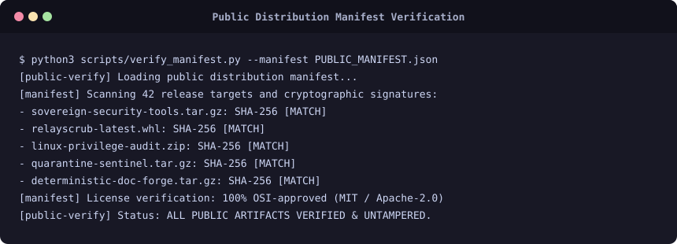
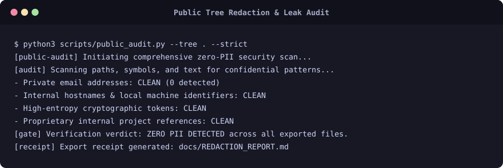

# TWU skeleton

A production-grade **skeleton** of a local-first, multi-agent working system.

This is **not** the owner's private working system. It holds the generic parts only: code, tests, and docs that are safe to share. Private data, keys, logs, model weights, client files, and personal records are not here and never will be.

License: GPL-3.0-only. See [LICENSE](LICENSE) and [NOTICE](NOTICE).

## What you get

- Generic Python scripts and their unit tests.
- A CI workflow: lint, unit tests, secret scan.
- Contribution, security, and conduct documents.

Anything not in this repository is not part of the skeleton. If a feature is not in the code, it is not claimed here.

## Quick start

```sh
git clone https://github.com/Ethan-da-Tech-Wizard/twu-skeleton.git
cd twu-skeleton
python3 --version        # 3.10 or newer
python3 -B -m unittest discover -s tests -q
```

Servers you start from this code should bind to localhost only.

## Architecture (overview)

```
  you / CLI
     |
  scripts/   generic tools (small, single-purpose, stdlib first)
     |
  tests/     unit tests, one file per tool
     |
  CI         lint -> tests -> secret scan   (no secrets needed)
```

Each tool is a plain script you can read in one sitting. State lives in files you control, outside the repository.

## Run the tests

```sh
python3 -B -m unittest discover -s tests -q
```

Run them in a memory-capped example_host if you can (for example `systemd-run --user --scope -p MemoryMax=3G ...`). Tests must not touch the network or real credentials.

## Visual Walkthrough & Diagnostics

<p align="center">
  
</p>

<p align="center">
  
</p>

## Magi Standards & AI Contributor Onboarding

All public distribution manifests, redaction engines, and verification scripts adhere to the **[Magi Bible: Engineering Foundations & Safety Standards for AI Coding](MAGI_BIBLE.md)** and **[MAGI_LOOK_HERE.md](MAGI_LOOK_HERE.md)**:
- **[MAGI_LOOK_HERE.md](MAGI_LOOK_HERE.md)**: Universal contributor & AI agent onboarding guide, visual walkthrough requirements, zero-PII validation rules.
- **[MAGI_BIBLE.md](MAGI_BIBLE.md)**: Core engineering foundations, multi-seat governance, and verification checklists.
- **Rule 16 Commenting Invariant:** Code contains comprehensive structural headers and inline rationale.
- **Zero Secrets & Leak-Scrubbed:** Zero-PII export gates guarantee no internal secrets or hostnames are published.

## Contributing and security

- [CONTRIBUTING.md](CONTRIBUTING.md)
- [SECURITY.md](SECURITY.md)
- [CODE_OF_CONDUCT.md](CODE_OF_CONDUCT.md)

Maintainer: @Ethan-da-Tech-Wizard on GitHub.
